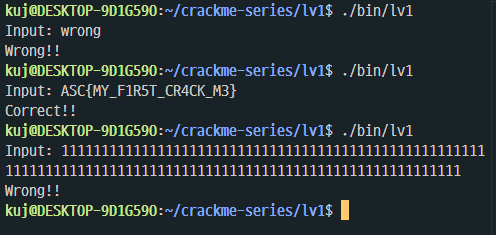
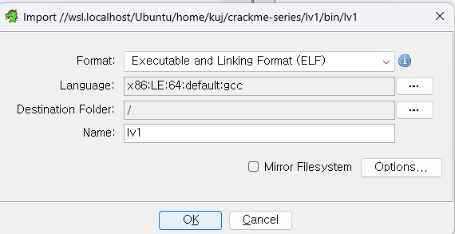
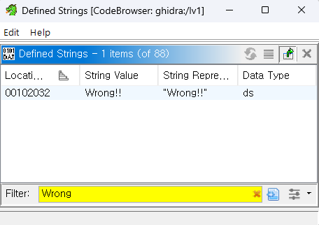
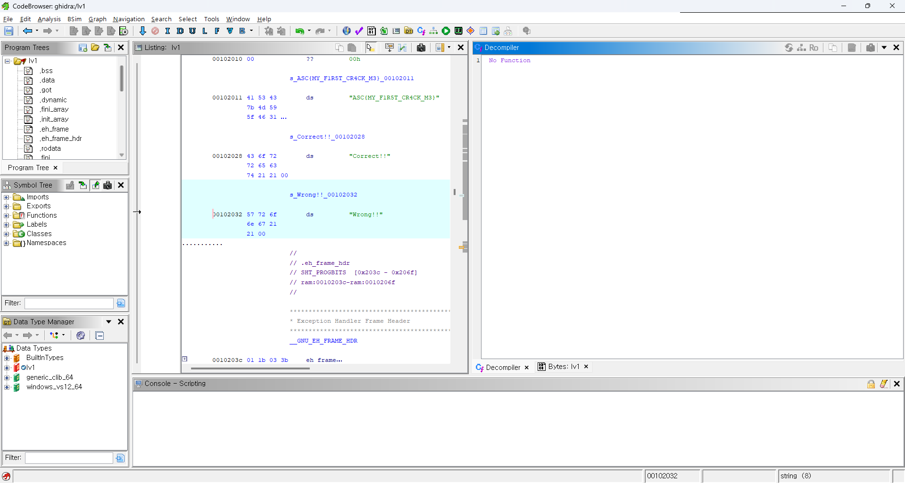
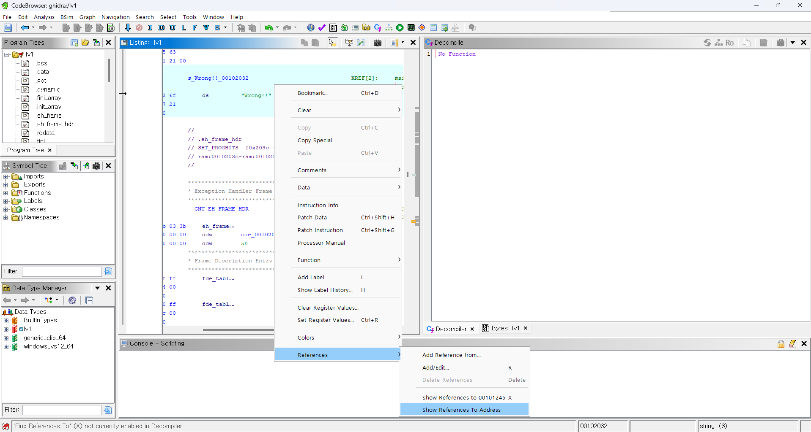
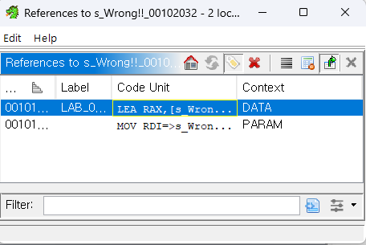
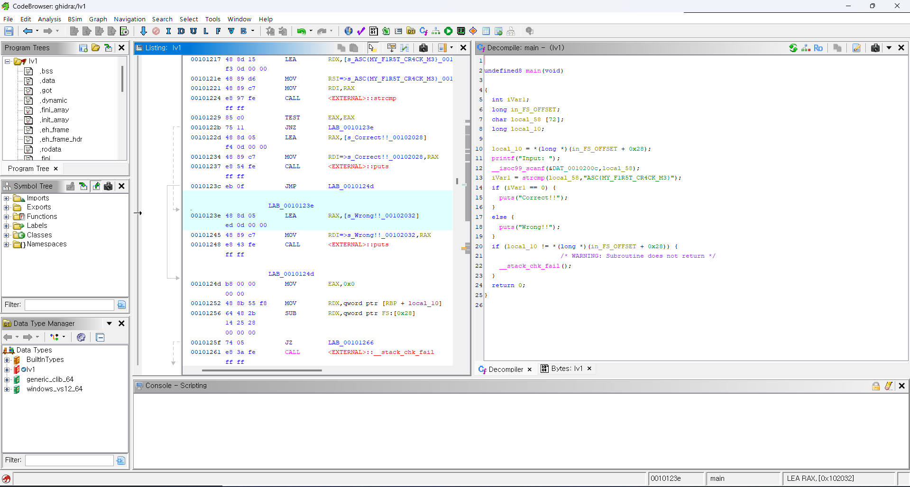
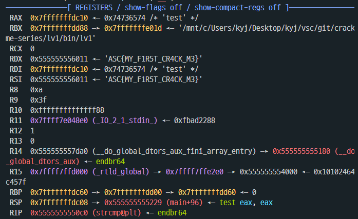
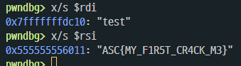
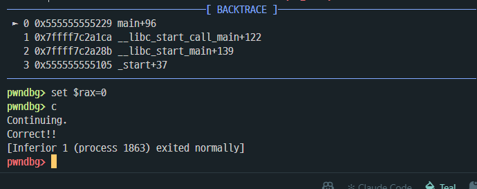

# Lv1 write-up

> 정답이 포함되어 있습니다. 먼저 `bin/lv1`만으로 풀어본 뒤에 읽는 것을 권장합니다.

## 문제 정보

| 항목 | 내용 |
|---|---|
| 파일 | `bin/lv1` (ELF 64-bit, x86-64, 동적 링크, strip 안 함) |
| 빌드 | `gcc -O0 -o bin/lv1 src/lv1.c` |
| 목표 | `Correct!!`가 출력되는 입력 찾기 |
| 핵심 기법 | 하드코딩된 키 + `strcmp` 문자열 비교 |
| 배우는 것 | 문자열 검색으로 검증 루틴 찾기, 비교 함수의 인자 확인 |

```
$ ./bin/lv1
Input: wrong
Wrong!!
```



## 설계 의도

리버싱을 처음 해보는 사람이 "프로그램 안의 문자열은 그대로 보인다"는 것과 "검증은 결국 비교 함수 하나로 모인다"는 것을 체험하는 단계로 만들었다.

- 키를 평문 문자열로 소스에 그대로 넣었다.
- `-O0`으로 최적화를 꺼서 디컴파일 결과가 소스와 비슷하게 나오게 했다.
- strip을 하지 않아 `main` 등 함수 이름이 남는다.
- 동적 링크라 `strcmp`, `puts` 같은 라이브러리 함수 이름도 그대로 보인다.
- 입력은 `scanf("%63s", input)`로 받아 64바이트 버퍼를 넘지 않게 했다.

## 풀이 1: 정적 분석 (Ghidra)

### 1) 바이너리 불러오기

File → Import File로 `bin/lv1`을 불러온다. 형식은 ELF, 언어는 `x86:LE:64:default:gcc`로 자동 인식된다.



### 2) 출력 문자열 찾기

Window → Defined Strings에서 실패 메시지 `Wrong!!`을 검색한다.



더블클릭해서 Listing으로 이동하면 `Wrong!!` 바로 위에 `Correct!!`와 `ASC{...}` 형태의 문자열이 나란히 저장되어 있다. 이 단계에서 이미 정답 후보가 보인다.



### 3) 참조 따라가기

`Wrong!!` 위에서 우클릭 → References → Show References To Address를 누르면 이 문자열을 쓰는 곳이 2개(DATA, PARAM) 나온다. 둘 다 같은 함수(`main`) 안의 연속된 명령이라 어느 쪽을 눌러도 같은 위치로 간다.




### 4) main 디컴파일 확인

```c
printf("Input: ");
__isoc99_scanf(&DAT_0010200c, local_58);
iVar1 = strcmp(local_58, "ASC{MY_F1R5T_CR4CK_M3}");
if (iVar1 == 0) {
    puts("Correct!!");
}
else {
    puts("Wrong!!");
}
```



입력(`local_58`)을 `ASC{MY_F1R5T_CR4CK_M3}`와 `strcmp`로 비교하고, 같으면(0) `Correct!!`를 출력한다. 따라서 정답은 이 문자열이다.

### 소스와 디컴파일 결과의 차이

| 소스 | 디컴파일 | 이유 |
|---|---|---|
| `printf("Correct!!\n")` | `puts("Correct!!")` | 서식 없이 `\n`으로 끝나는 printf를 gcc가 puts로 바꿈 (`-O0`에서도 적용) |
| `scanf` | `__isoc99_scanf` | glibc에서 C99 표준 scanf의 실제 심볼 이름 |
| `char input[64]` | `char local_58[72]` | 배열 크기 정보가 사라져 Ghidra가 스택 배치로 추정 |
| `"%63s"` | `&DAT_0010200c` | 서식 문자열에 타입이 붙지 않아 DAT_로 표시 |
| (없음) | `local_10`, `in_FS_OFFSET + 0x28`, `__stack_chk_fail` | gcc가 기본으로 넣는 스택 카나리 |
| `int main` | `undefined8 main` | 반환 타입 정보가 사라짐 |

Listing에서는 `if` 문이 다음 두 명령으로 바뀌어 있다.

```
00101229  TEST EAX,EAX          ; strcmp 결과가 0인지 검사
0010122b  JNZ  LAB_0010123e     ; 0이 아니면 Wrong!! 쪽으로 점프
```

## 풀이 2: 동적 분석 (GDB)

환경: WSL Ubuntu, GDB + pwndbg

### 1) 비교 직전에 멈추기

```
$ gdb -q ./bin/lv1
pwndbg> b strcmp@plt
pwndbg> r
Input: test
```

> **참고: `b strcmp`가 아니라 `b strcmp@plt`를 쓰는 이유**
> `b strcmp`로 걸면 프로그램이 시작될 때 동적 로더(`ld-linux`)가 내부적으로 호출하는 strcmp에서도 멈춰서, `Input:`이 나오기 전에 계속 멈춘다. `strcmp@plt`는 lv1 안에서 libc의 strcmp를 부르는 호출 창구(PLT)라서, main의 strcmp 호출에서만 멈춘다.

### 2) 인자 확인

x86-64 System V 호출 규약에서 첫 번째 인자는 rdi, 두 번째 인자는 rsi에 들어간다. `strcmp(input, 정답)`이므로 rsi에 정답이 있다.



```
pwndbg> x/s $rdi
0x7fffffffdc10: "test"
pwndbg> x/s $rsi
0x555555556011: "ASC{MY_F1R5T_CR4CK_M3}"
```



- RDX에도 같은 주소가 들어 있는데, 디컴파일 전 Listing에서 본 것처럼 `LEA RDX, [키]` → `MOV RSI, RDX` 순서로 인자를 준비했기 때문이다.
- 정답 문자열 주소 `0x555555556011`은 PIE 베이스 `0x555555554000` + `0x2011`이다. Ghidra는 같은 바이너리를 베이스 `0x100000`으로 불러오므로 Ghidra 주소 `0x00102011`과 같은 위치다.
- 스택 맨 위의 반환 주소 `main+96`(`0x555555555229`)은 Ghidra의 `00101229 TEST EAX,EAX`와 같은 명령이다.

### 3) 반환값을 바꿔서 우회하기

정답을 몰라도, strcmp의 결과만 "같다(0)"로 바꾸면 검증을 통과할 수 있다.

```
pwndbg> finish          # strcmp를 끝까지 실행하고 main으로 복귀
pwndbg> set $rax=0      # 반환값(rax)을 0으로 변경
pwndbg> c
Continuing.
Correct!!
[Inferior 1 (process 1863) exited normally]
```



입력은 `test`였지만 `TEST EAX,EAX`가 0을 보고 `JNZ`로 점프하지 않아 `Correct!!`가 출력되었다. 이 방법은 실행할 때마다 디버거가 필요하다. 같은 효과를 실행 파일 자체에 영구적으로 남기는 것이 바이너리 패치(`JNZ` 수정)이며, Lv2에서 실험한다.

## 정리: 왜 Lv1인가

- 정답이 평문 문자열이라 Defined Strings만 훑어도 찾을 수 있다.
- 디컴파일 결과가 소스와 거의 같아 어셈블리를 몰라도 흐름을 읽을 수 있다.
- 비교가 `strcmp` 한 번이라, 디버거로 비교 직전에 멈추면 두 번째 인자에 정답이 그대로 들어 있다.

Lv2에서는 키를 평문으로 두지 않고 XOR 등의 연산으로 감춰서, 문자열 검색만으로는 풀 수 없게 만든다. 또 위의 `JNZ` 같은 분기를 바이너리 패치로 우회할 수 있는지도 실험한다.
